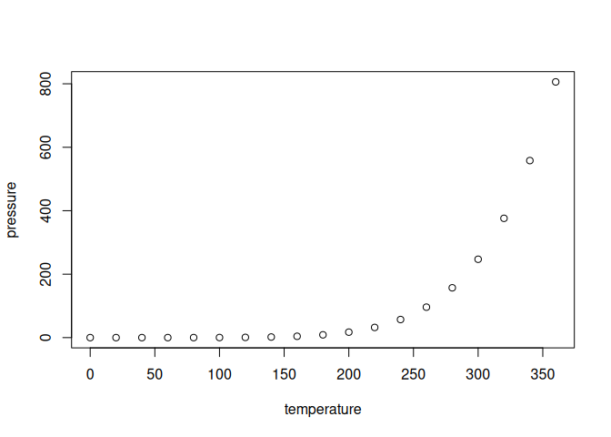

<!-- README.md is generated from README.Rmd. Please edit that file -->

# powers Package

This is a minimal working example of my first R Package for STAT545!

## Installation

Package installation can be done directly by calling
`devtools::install_github("YOUR_GITHUB_USERNAME/powers")`

## Example

This is a basic example which shows you how to solve a common problem:

``` r
library(powers)
square(c(2,4,5))
#> [1]  4 16 25
```

    What is special about using `README.Rmd` instead of just `README.md`? You can include R chunks like so:


    ``` r
    summary(cars)
    #>      speed           dist       
    #>  Min.   : 4.0   Min.   :  2.00  
    #>  1st Qu.:12.0   1st Qu.: 26.00  
    #>  Median :15.0   Median : 36.00  
    #>  Mean   :15.4   Mean   : 42.98  
    #>  3rd Qu.:19.0   3rd Qu.: 56.00  
    #>  Max.   :25.0   Max.   :120.00

You’ll still need to render `README.Rmd` regularly, to keep `README.md`
up-to-date. `devtools::build_readme()` is handy for this.

You can also embed plots, for example:



In that case, don’t forget to commit and push the resulting figure
files, so they display on GitHub and CRAN.
